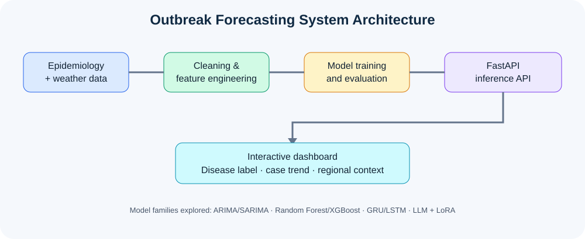
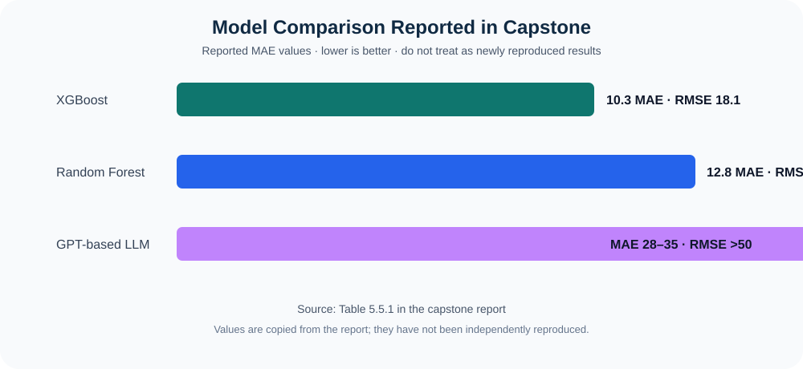

# Forecasting Flu Outbreaks with Time-Series LLMs

A reconstruction of the VIT-AP capstone *Forecasting Flu Outbreaks with Time-Series LLMs: Leveraging Weather and Environmental Signals*.

The goal is to predict disease category and weekly case counts using temporal, geographic and environmental features such as week, state/district, temperature, precipitation, LAI and coordinates. The report compares ARIMA/SARIMA, Random Forest/XGBoost, GRU/LSTM and an LLM + LoRA experiment. Its described deployed design uses a classifier and regressor behind FastAPI with a dashboard.

> **Important:** The original dataset (`Final_data.csv`), fitted model artifacts and original frontend source were not in this repository snapshot. This repo includes a runnable reconstruction, data-preparation/training code and a clearly labeled demo mode. Demo outputs are illustrative, not validated epidemiological forecasts.


[Capstone report.pdf](https://github.com/user-attachments/files/33627787/Capstone.report.pdf)


## Project visuals

### System architecture



### Model comparison reported in the capstone



The comparison graphic reproduces the MAE/RMSE values printed in Table 5.5.1 of the report; it is a visual rendering of reported values, not a new evaluation run.

## Capstone report and source-code appendix

The report's appendix (Chapter 8, PDF pages 51–96) contains preprocessing, feature engineering, Random Forest/XGBoost and GRU/LSTM examples, LLM prompt construction, FastAPI endpoints, dashboard React snippets and final classifier/regressor code. See [Appendix implementation notes](docs/REPORT_APPENDIX_NOTES.md) for an index and the important implementation details used in this reconstruction.

**PDF note:** the uploaded original PDF was available for analysis in this conversation, but the connected GitHub file operation only supports UTF-8 text files, not binary PDF uploads. I have not placed a fake or corrupted PDF in the repository. Upload `Capstone report.pdf` to the repository's `report/` folder using GitHub's web UI to make the original PDF downloadable alongside the DL project report.

## Included
- `backend/`: FastAPI API: `/health`, `/predict_disease`, `/predict_cases`, `/forecast`.
- `dashboard/`: Streamlit dashboard with a multi-week forecast chart and CSV download.
- `src/data/`: dataset cleaning and feature normalization.
- `src/models/`: Random Forest classifier and Random Forest/XGBoost regressor pipelines.
- `scripts/`: preprocessing and model-training commands.
- `notebooks/`: experiment scaffold and data checks.
- `docs/`: data schema, reproducibility caveats and optional LLM experiment.
- `tests/`: basic preprocessing/API tests.

## Quick start

Python 3.10+ recommended.

```bash
python -m venv .venv
# Windows PowerShell: .venv\Scripts\Activate.ps1
# macOS/Linux: source .venv/bin/activate
pip install -r requirements.txt
```

Start the API and dashboard in two terminals:

```bash
uvicorn backend.main:app --reload
streamlit run dashboard/app.py
```

Open the dashboard at `http://localhost:8501` and API docs at `http://127.0.0.1:8000/docs`. Without trained artifacts, the app runs in demo mode and labels outputs accordingly.

## Train on the original data

Obtain the CSV used by the original team and place it at `data/raw/Final_data.csv`. Then:

```bash
python scripts/prepare_data.py --input data/raw/Final_data.csv
python scripts/train_models.py
```

Model files and run metrics are saved under `artifacts/`. To use XGBoost for case-count regression, install it with `pip install xgboost`, then run:

```bash
python scripts/train_models.py --regressor xgboost
```

The preprocessing code handles week parsing, duplicate removal and temperature values that appear to be Kelvin. By default, it excludes years 2020–2022 as described in the report appendix; use `--keep-pandemic-years` to turn off this filter.

## API example

```json
{
  "week_of_year": 40,
  "state_ut": "Andhra Pradesh",
  "district": "Guntur",
  "temp_celsius": 28.5,
  "preci": 50.0,
  "lai": 1.2,
  "latitude": 16.3,
  "longitude": 80.4
}
```

Send this body to `POST /forecast?horizon=6`; use the same body at `/predict_disease`, or add `"Disease": "Dengue"` and send it to `/predict_cases`.

## Report alignment and limitations

The capstone PDF names Random Forest/XGBoost as the most stable approach on the main structured dataset, and describes a Gemma-2B + LoRA experiment plus a Dengue-specific validation dataset. LLM fine-tuning is documented separately because model weights are large and the report does not provide a deployable checkpoint. See `docs/LLM_EXPERIMENT.md`.

Metrics generated by this reconstruction must not be confused with metrics recorded in the capstone report. The training script uses a random split for an initial baseline; use chronological train/test splits and external validation for credible forecasting. This software is a research prototype, not a medical or public-health decision tool.

**Original capstone team:** Chinnola Akash Rao, Aditya Nair, Nandana S Krishna and Edhara Jnaneswar Chowdary, under Dr. S. Kalyani, VIT-AP University (December 2025).
